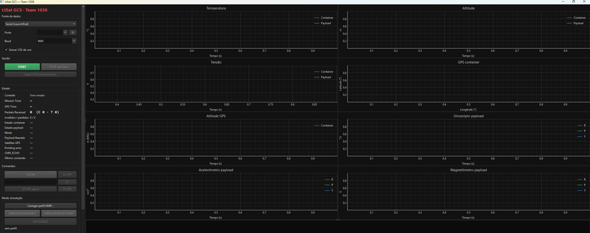

<h1 align="center">HMI_2022 - LtSat 🇧🇷</h1>
<h2 align="center"> GCS CanSat competition 2022 - LtSat </h2>
<a href="https://www.cansatcompetition.com/docs/CanSat_Mission_Guide_2022.pdf">Mission Guide 2022</a>
<h4 align="start">Objetivos da missão: </h4>
<p align="start">
- A carga útil deve ser presa ao contêiner por um cabo de 10 metros de comprimento. </br>
- O Cansat será lançado a uma altitude que varia de 670 metros a 725 metros </br>
- Uma vez que o Cansat é lançado do foguete, o Cansat deve descer usando um pára-quedas a uma taxa de 15 m/s. A 400 metros, o Cansat deverá lançar um pára-quedas maior para reduzir a razão de descida para 5 m/s. A 300 metros, a carga útil deve ser lançada do contêiner. </br>
- Depois que a carga é liberada, ela deve descer a distância de 10 metros em 20 segundos. Durante esse tempo, a carga útil deve manter a orientação de uma câmera de vídeo apontando para o sul. A câmera de vídeo deve ser apontada 45 graus para baixo.
</p>


-> -> -> ->

#### Transmissão da telemetria:
- O container deve transmitir a sua telemetria a 1Hz no formato descrito pela competição.
- O contanier deve sondar a telemetria da carga util e a retransmitir a uma velocidade de 4Hz no formato descrito pela competição.


##### Sensores que compoem a telemetria: 
- Temperatura, Gps, Giroscopio, Acelerometro, Magnetometro


##### LISTA DE ATRIBUTOS E POSIÇÃO NO VETOR SERIAL (USB cable)


Posição   | Atributo
--------- | ------
 0 | Altitude Container
 1 | Temperatura Container
 2 | Voltage Container
 3 | pakage type
 4 | Gps Latitude Container
 5 | Gps Longitude Container
 6 | Gps Altura Container
 7 | Altitude Payload
 8 | Temperatura Payload
 9 | Voltage Payload
 10 | GiroscopioR
 11 | GiroscopioP
 12 | GiroscopioY
 13 | AcelerometroR
 14 | AcelerometroP
 15 | AcelerometroY
 16 | MagnetometroR
 17 | MagnetometroP
 18 | MagnetometroY
 


---

<h2 align="center">GCS V2 — Refatoração 🛰️</h2>

A V2 é uma reescrita completa da Ground Control Station, localizada em [`GUI_2022/V2`](GUI_2022/V2). O código da primeira versão foi mantido no repositório apenas como referência.

#### Por que refatorar

A refatoração foi necessária devido ao mau funcionamento de alguns módulos desenvolvidos na primeira versão:

- **Inicialização:** a interface não abria por causa de um import circular entre `main.py` e `tela.py`, e os botões executavam suas ações no momento em que eram criados, não no clique.
- **Comunicação serial:** a porta era aberta assim que o módulo era importado, e o buffer de entrada era limpo antes de cada leitura, descartando pacotes.
- **Dados:** havia campos trocados entre arquivos (por exemplo, a altitude do GPS gravada no arquivo de longitude e o magnetômetro recebendo valores do acelerômetro), e o CSV final exigido pelos juízes nunca era gerado.
- **Formato:** o protocolo usado na serial (19 campos posicionais, tipos `c`/`t`) não seguia o formato oficial de telemetria da competição.
- **Portabilidade:** caminhos absolutos e porta serial fixos no código faziam o software rodar em apenas uma máquina Linux.
- **Funcionalidades faltando:** não havia envio de comandos, modo simulação nem MQTT, todos previstos no PDR.

#### Refatoração arquitetural

O projeto foi reorganizado em camadas independentes, cada uma com testes automatizados:

| Camada | Responsabilidade |
|--------|------------------|
| `protocol` | Parsing dos pacotes oficiais C (container) e T (payload) e montagem dos comandos `CX`, `ST`, `SIM` e `SIMP` |
| `transport` | Fontes de dados: porta serial com reconexão automática, replay de voos gravados e um CanSat simulado para testes sem hardware |
| `core` | Controle da sessão (START / STOP and Save), armazenamento da telemetria, estatísticas de pacotes perdidos e modo simulação a 1 Hz |
| `persistence` | Gravação de `Flight_1038_C.csv` e `Flight_1038_T.csv` linha a linha, em uma pasta por sessão |
| `mqtt` | Publicação da telemetria no broker configurado por variáveis de ambiente (tópico padrão `teams/1038`) |
| `ui` | Interface gráfica, sem lógica de missão |

A recepção serial roda em uma thread própria e entrega as linhas por uma fila à thread principal, de modo que a interface nunca trava esperando dados e nenhum pacote é perdido pela tela.

#### Refatoração visual

A interface foi refeita em **PySide6 + pyqtgraph** (no lugar de Tkinter + matplotlib), mantendo o layout apresentado no PDR:

- **Painel lateral:** escolha da fonte de dados, sessão, indicadores (Mission Time, GPS Time, Packets Received, estados do container e do payload, modo, pointing error), comandos, modo simulação e MQTT.
- **Gráficos:** os 8 gráficos em tempo real (temperatura, altitude, tensão, GPS, altitude GPS, giroscópio, acelerômetro e magnetômetro), atualizados sem travar a janela.
- **Terminal:** log de eventos colorido por nível na parte inferior.
- **Tema escuro** e botões que só ficam ativos quando a ação é possível.



#### Como executar

```powershell
cd GUI_2022/V2
python -m venv .venv
.venv\Scripts\python -m pip install -e ".[dev]"
.venv\Scripts\python -m gcs
```

O planejamento completo da refatoração está em [`GUI_2022/V2/PLANEJAMENTO.md`](GUI_2022/V2/PLANEJAMENTO.md), e a descrição técnica do projeto em [`GUI_2022/V2/context.md`](GUI_2022/V2/context.md).
